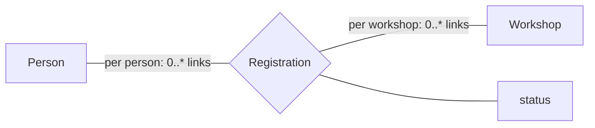

# ER Modelling Decisions: plugin design

Status: registration-profile schemas and engine implemented, 2026-11-06.
The [frozen engine contract](er-registration-engine-contract.md) and
[validation record](er-registration-engine-validation.md) describe the available
slice. The [provider](../../plugins/er-decisions/README.md) now also provides
[prepared authoring](../er-decisions-authoring.md), a style and static editions
for registrations. The [lesson-state protocol](../er-decisions-state.md) is
implemented; the interactive classroom interface remains pending.
Room identification and open assumptions below
remain target features. See the [implementation plan](er-modelling-decisions-plan.md),
[target lesson contract](er-modelling-decisions-contract.md) and
[worked design examples](er-modelling-decisions/README.md).

## 1. Purpose

Students turn a short description of a small organisation into modelling
decisions, inspect the resulting ER diagram and explain their choices.
The activity asks **what a model permits and excludes**, rather than whether
its drawing resembles an instructor's diagram.

The first lesson uses a fictional community learning centre:

1. People register for workshops. Where does registration status belong?
2. Room numbers are unique within a building. How is a room identified?
3. Every student has a mentor. Must every mentor already have a student?

The learning outcomes are to distinguish entities from properties, identify
relationship attributes, interpret participation and cardinality, choose
scoped keys, and recognise missing requirements. Students should be able to
give a small example that exposes a wrong restriction and state an assumption
when the scenario does not settle a decision.

Entity sets, relationship attributes, participation, scoped identification and
the possibility of several good designs follow the conceptual modelling
material in [Database System Concepts, chapter 6](https://www.db-book.com/slides-dir/PDF-dir/ch6.pdf).
The bounded activity, assessment policy and interfaces below are our design
choices. All accompanying people, identifiers and data are synthetic.

## 2. First release: guided modelling, not diagram matching

V1 has two lesson modes sharing one answer format:

- **Decide:** complete a small model using labelled decision cards. Each card
  changes a declared property of the model and immediately updates its diagram.
- **Repair:** start with a complete but flawed set of decisions, change one or
  more, and submit a coherent replacement. Highlight changes; do not require
  the shortest repair.

Each exercise has at most four cards, each with at most four options. Options
compose into one model; they are not independently scored multiple-choice
questions. For example, choosing an association entity does not remove the
requirement that a person can register only once for a particular workshop.

Supported decisions:

| Decision | V1 representation | Teaching question |
| --- | --- | --- |
| Participation/cardinality | Binary role, minimum 0 or 1; maximum 1 or many | Can an entity exist with no links? Can it have several? |
| Attribute placement | One scalar attribute on either endpoint or their relationship | Whose fact is this? |
| Relationship versus association entity | Binary relationship, or reified entity with explicit pair uniqueness | Does adding an ID preserve the business constraint? |
| Identification | Global key, owner plus discriminator, or surrogate plus scoped uniqueness | Is room 101 globally unique? |
| Unspecified requirement | Explicit, mutually exclusive assumption choices, including unresolved | What must we ask the client? |

The initial graph is authored; students choose meaningful changes rather than
draw arbitrary shapes. V1 includes a readable diagram, accessible textual
equivalent and decision controls on phones. A JSON editor is a development
tool only, not completion of the student interface.

Later work may add a free-form ER editor, ternary relationships, specialization,
multi-valued/composite attributes, temporal histories, recursive identification,
ER-to-SQL mapping and student-created counterexamples. V1 does not claim
general ER equivalence, automatic interpretation of prose or automatic grading
of free-text justifications. It does not execute DDL or alter SQL activities.

## 3. Assessment: several defensible answers

The engine answers a bounded question: **does this selected model admit the
examples it should admit, and reject those it should reject?**
It also checks model structure. It returns facts; the lesson owns feedback.

| Finding | Student feedback |
| --- | --- |
| Structurally invalid combination | Explain the incompatible choices; keep the draft |
| A permitted snapshot is rejected | “This model excludes a situation the requirements allow” |
| A forbidden snapshot is accepted | “This model permits a situation the requirements forbid” |
| All stated checks pass | “Consistent with the checked examples” |
| Checks pass under an explicit assumption | “Consistent under your stated assumption” |
| A relevant requirement remains unspecified | “Needs clarification”; compare alternatives |
| Optional written justification | “For discussion”; never silently mark it automatically correct |

A passing finite suite is not a proof that two ER models describe exactly the
same possible worlds. Reference canonical equality is not correctness.
Different models can receive the same favourable feedback while retaining
different canonical identities. Do not show an overall numeric grade in v1.
Show findings and requirement coverage, including unchecked/discussion items.

An assumption cannot override a stated fact. The author must mark exactly
which requirement is open and offer its allowed interpretations. A student
cannot invent an assumption that excuses a contradiction. With no selected
assumption, evaluate the fixed facts, show the open question, and do not
penalize either plausible interpretation solely on the unresolved point.

Hidden examples may probe stated requirements; they may not introduce new
requirements. Explanation prose is visible to the presenter only until
explicitly shared. The plugin does not claim to understand or verify that prose.

### Worked decisions

**Workshop registrations.** A person may register for zero or more workshops;
a workshop may have zero or more participants. There is at most one
registration per person/workshop pair, with one status per registration.
A person can be confirmed for one workshop and waitlisted for another.
Two people in one workshop can have different statuses.

- Putting status on Person or Workshop imposes an unwanted functional
  dependency. Show the two conflicting records as the witness.
- Person participation is `0..*`. A pre-registered person with no workshop
  refutes `1..*`; one person attending two workshops refutes `0..1`.
- Both a relationship carrying status and an association entity with a unique
  person/workshop pair pass. A surrogate registration ID alone does not
  enforce pair uniqueness.

**Rooms and buildings.** Room numbers are unique per building, and every room
has exactly one building. Two buildings may each contain room 101.
An owner-identified Room and a strong Room with its own ID plus uniqueness
of (building, number) both pass the checked examples. Global room-number
uniqueness excludes an allowed example; a surrogate alone admits a duplicate
room number within one building. Existence dependence does not imply a
particular SQL delete/cascade policy.

**Mentors.** Each student has exactly one mentor. A mentor may have many
students, but the brief deliberately leaves open whether an unused mentor can
exist. “Unused mentors allowed” and “every mentor already assigned” are
alternative assumptions. Without clarification, both candidate minima remain
discussion choices. Once an assumption is selected, a snapshot containing an
unused mentor discriminates them. Empty data never proves participation.

The [example record](er-modelling-decisions/README.md) includes hand-derived
expectations and an independent checker. Its finite checks do not validate
the still-unimplemented runtime.

One accepted registration model is:

The alternative reifies Registration as an entity while retaining uniqueness
of the Person/Workshop pair. These are semantic alternatives, not merely
different layouts of the same picture.

## 4. Semantics and diagram notation

V1 is a current snapshot of finite entities and binary links, with scalar,
non-null attributes. Entity identity is distinct from display names. Reference
targets must exist. A relationship instance is a pair of role occupants;
reification introduces an occurrence identity but must explicitly preserve
pair uniqueness where the requirements demand it.

Use an explicit min/max legend. A label beside **Person** means “for each
Person, how many Registration links may contain that Person?” It does not
describe the opposite endpoint. Every diagram also displays that sentence.
Do not mix this convention with unlabelled crow's-foot endpoint notation.
Roles have stable IDs, even when display labels repeat.

For a role with bounds `m..n`, count its incident links for **every** entity,
including those with zero links. No upper limit is encoded as `"many"`, not as
the largest fixture size. A key requires all components and uniqueness among
distinct entities. Owner identification additionally requires exactly one
existing owner. An attribute moved to an entity must have one value for each
entity across every observation that mentions it.

Candidate diagrams and evaluator constraints come from the same typed model
compiler. The author does not maintain separate “right answers”, unrelated
constraint lists and pictures. Templates may reify a relationship or change
identification, but not execute scripts or arbitrary JSON patches. Conflicting
writes, dangling targets, cycles of ownership and impossible bounds are rejected.
The [contract](er-modelling-decisions-contract.md) fixes the intended boundary.

## 5. Classroom workflow

1. **Introduce:** projector shows the brief, known facts, explicitly open
   questions, initial diagram and one small example. Phones can read them.
2. **Open:** phones show one card at a time, a progress summary, assumptions and
   optional rationale. “View model” opens the diagram and textual constraints.
   A local preview uses only public examples and reports structural problems.
3. **Submit:** save the whole bounded decision set and queue one authoritative
   evaluation. The phone distinguishes saved, pending, evaluated and failed.
   No evaluation occurs on each tap or keystroke.
4. **Close and discuss:** freeze submissions, retain pending accepted work,
   show anonymous option counts, and inspect selected answers in presenter view.
   The presenter may explicitly share a pseudonymous model for discussion.
5. **Reveal:** release compact individual feedback, selected teaching witnesses
   and worked alternatives. Reveal does not publish the entire private suite.
6. **Reset/new round:** use the host epoch reset. Old results cannot overwrite
   new answers. Another repair attempt is a new round, not reopening an
   already-revealed grading oracle without warning.

The projector initially retains useful static material. Its overlay shows only
selected additions, not an empty opaque panel. On reveal, compare two diagrams
side by side where space allows, or alternate between them with textual
differences. Counts describe choices, not a class “correctness leaderboard”.

Phones at 320 CSS pixels need labelled tap controls, keyboard operation,
visible focus, adequate touch targets, a progress indicator and readable
constraint sentences. Dragging, hover, colour and zooming a large canvas
must not be required. English and German labels use stable shared semantic IDs.
Preserve draft, focus and scroll across unrelated updates. On a newer same-user
answer or epoch reset, offer reload/keep draft; never resubmit automatically.

## 6. Provider and core ownership

| Proposed identity | Responsibility |
| --- | --- |
| Distribution `texstage-er-decisions` | One portable Apache-2.0 wheel |
| Provider `io.github.stefanjdecker.erdecisions` | Owned resources and factory |
| Engine `io.github.stefanjdecker.erdecisions.model` | Compile choices; validate bounded snapshots; return typed facts |
| Content type `io.github.stefanjdecker.erdecisions.lesson` | Authoring, feedback policy, phases, role views |
| `texstage-er-decisions.sty`; namespace `er` | Thin prepared-authoring wrapper |
| `\erdecisions{item}{width}{height}` | Prepared slide command (registration slice implemented) |

The distribution, provider and engine identifiers are implemented locally;
the content type and style remain proposed. No catalog release exists. Use manifest
revision 2 and API 1. One distribution avoids unnecessary package coupling;
its engine remains a separately declared capability. Pure owned model code
can serve public phone preview and presenter-worker evaluation. The preview
never receives private bindings and has no grading authority.

TeXStage retains authentication, persistence, receipts, epochs, supervision,
schemas, resource confinement and renderer lifecycle. The provider retains
all ER rules, model compilation, UI and classroom policy. No ER-specific
core route, SQL table, DSL, diagram library or lecture-tools change is needed.
Do not import private modules from the relational provider. Reuse SDK patterns,
not another provider's installed implementation.

Operators install, enable and pin providers explicitly. A slide upload,
activity sidecar or `\usepackage` never installs code. The collection catalog
should gain an entry only after a reviewed immutable release exists.

## 7. Authoring and static outputs

One lesson source contains the brief, facts/open questions, base model,
typed decision slots, public examples, private checks, worked alternatives
and explanations. Prepared authoring validates every option and all bounded
combinations, checks each worked alternative and emits:

- Public problem data and the schema for public preview.
- Private evaluation seed, expectations and release policy.
- Exercise and solution TeX fragments derived from the same model.
- Approved diagram assets and an accessible textual representation.

The explicit `lesson.activities.json` names the content type and source.
Sources and assets remain under the master deck directory. Use SDK
`PreparedAuthoring`, `PreparedItem` and `latex_escape`; the style wraps
`\texstageprepared`. Author prose is plain text, not executable TeX/SVG/HTML.
Render layout from bounded trusted templates; escape text in every output.

The handout contains the brief, unfilled choices and space for assumptions.
Solutions show multiple acceptable checked alternatives, counterexamples and
open questions, not a single “canonical ER diagram”. Live slides, handout,
solutions and static PowerPoint must agree. Direct-pdfLaTeX output remains
a local materialized export, following the existing host mechanism.
Preparation files can contain private answers and are not a student download.

## 8. Host fit and risks exposed by this design

Reviewed against local host `de3351550f3553ca63023554521fbe84806ec94e` and
collection `5f00b62f6292de01e4eca067c8acd96dddf67eb9`. These are development
commits, not released compatibility pins.

| Question raised by ER activities | Design resolution |
| --- | --- |
| Multiple acceptable diagrams | Typed evidence and lesson policy; ignore `matches` as a correctness flag |
| Assumptions and discussion | Provider-specific evidence states; no new universal host grade enum |
| Composing choices | Bounded typed provider compiler; no general host expression interpreter |
| Live/static diagram agreement | One model compiler and prepared source; verify rendered output |
| Private examples and explanations | Distinct closed role views; explicit release of approved witnesses only |
| Large diagram/state payloads | Store option IDs and compact findings; recompute diagram; enforce serialized budgets |
| Two phone tabs and presenter changes | Actor/phase/control versions plus host receipts/epochs |
| Browser worker restrictions | Committed self-contained worker bundle; unchanged production CSP |

No new host API is currently justified. E0/E1 must prove the result and view
schemas fit the portable profile and the real installed host. If they expose
a generic defect, fix it separately with regressions for existing providers;
do not silently raise limits or weaken security.

The principal remaining risks are ambiguous endpoint labels, incorrectly
classified witnesses, overclaiming finite checks, divergent static diagrams,
and accepting every model through an overly permissive assumption. Mitigate
them with hand-derived cases, an independent Python oracle, explicit open
requirements, several deliberately wrong models, and new-user UI checks.
Classroom throughput and physical-phone accessibility remain measured release
gates, not consequences of a passing pure-engine test.
