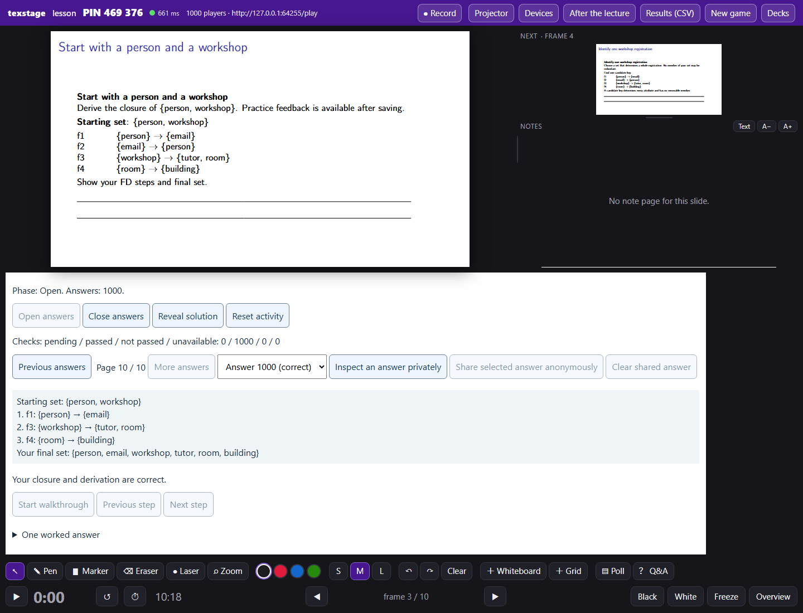

# FD Lab: 600-participant capacity candidate

Date: 2026-11-07. FD Lab 0.4.0 and the matching TeXStage capacity branch now
store and evaluate 600 students' answers correctly in the automated scenarios.
**The complete timing gate is still open:** feedback p95 must be below 10 seconds
in every burst. Chromium narrowly misses one burst; Firefox and WebKit miss it
more substantially. These measurements do not establish production readiness
for a 600-person lecture network.

There is also a merge prerequisite: newer uncommitted actor-record work appeared
in the shared host during this task. The
[integration review](functional-dependencies-capacity-integration.md) maps this
candidate onto that common API. The shared checkout was preserved; these are
isolated tested branches, not a merged or published release.

## What changed

- The generic host provides authenticated `actor-slots-v1` storage. Shared state,
  one student's slot, cancellation, evaluation jobs and receipts commit atomically.
- FD Lab keeps aggregate counters separately and shows 100 answers per presenter
  page. It stores up to 1,000 student slots, each bounded to 2 KiB. The whole class
  is no longer copied through every hook call or presenter refresh.
- Updates target the affected student's devices and the presenter. Large sends
  yield in groups of 16; shared controls still refresh everybody.
- Evaluation leases commit in bounded batches, with at most eight outstanding
  jobs per evaluator. Available cores limit browser concurrency. Refilling half
  a batch avoids one lease transaction per answer. Each job still uses a fresh
  worker with the original two-second deadline and network/child-worker restrictions.
- The live result path commits valid feedback and its delivered marker together.
  Queue capacity checks run only when a transition adds jobs; replacements look
  up their own cancelled jobs instead of copying every pending job.

Other providers retain their existing whole-item state model and limits. This
does not make the transaction, relational, SQL or SPARQL activities 600-student
certified. No original repository, course environment, course pin or private media
was modified.

## Measured results

Windows 10, Intel i9-11950H, 16 logical CPUs, 64 GiB RAM; Python 3.14.4,
Node 24.15.0, Playwright 1.62.1. Each browser ran sequentially on loopback, with
600 protocol participants, one real presenter evaluator, one rendered 320-pixel
participant view sharing student 1's identity, and a protocol control connection.
The load is a simultaneous answer burst, not 600 physical phones.

Each browser submitted 600 correct answers and then 600 replacements in each of
closure practice, all candidate keys, and implication counterexamples. All
10,800 answers were accepted and checked correctly. No pending jobs remained at
the end of any burst; FIFO leasing matched acceptance order. Keyboard input was
sampled throughout each burst, not only at its beginning.

| Presenter browser | Feedback p95 across six bursts | Worst feedback | Highest input p95 |
| --- | ---: | ---: | ---: |
| Chromium 151.0.7922.34 | 9.29–10.37 s | 10.65 s | 1.6 ms |
| Firefox 153.0 | 11.75–15.36 s | 15.42 s | 2 ms |
| WebKit 26.5 | 20.18–23.11 s | 24.09 s | 12 ms |

The input target (<100 ms p95) and worst-feedback target (<30 s) passed in every
600-student burst. The feedback p95 target (<10 s) did not pass consistently.
Strict enforcement stayed enabled; these runs therefore exit nonzero despite
completing the correctness scenarios.

Each browser also passed absent-evaluator persistence, same-student resume,
receipt replay, completion after closing an activity, evaluator replacement,
rejection of an old lease's result, and reset with a late result. Presenter
pagination reached and selected answer 600 without exposing the roster or
selected private answer to other students.

The separate Chromium headroom run accepted and checked 1,000 answers plus
1,000 replacements. Feedback p95 was 17.72 seconds in both bursts; the worst
feedback was 18.74 seconds and input p95 was 0.6 ms. Reconnect checks passed.
The presenter reached page 10 and visibly inspected answer 1,000:



Measured shared FD state at the end of a burst was 197–198 bytes; typical stored
slots were 359–406 bytes. The headroom run stored 406,000 bytes of actor data.
Server process working set peaked at about 402 MB in that run; this excludes
the browser and provider subprocess. These are measured example sizes, not
new limits on other valid FD answers.

## Artifacts and checks

[identity.json](functional-dependencies-600/identity.json) records the exact host,
provider payload and wheel/sdist hashes. The FD wheel used for capacity has the
same executable/resource payload as the final documentation rebuild; both wheel
hashes are retained. Raw result reports are available for
[Chromium](functional-dependencies-600/600-chromium.json),
[Firefox](functional-dependencies-600/600-firefox.json),
[WebKit](functional-dependencies-600/600-webkit.json), and
[1,000-student headroom](functional-dependencies-600/1000-chromium.json).

Validation: 113 FD/package-artifact tests, 67 transaction tests and 72 relational
tests passed in separate installed-wheel scenarios. The host suite covered 480
passing tests and one skip across the full run and targeted reruns. The initial
full run had six registry-fixture failures under the Windows sandbox and one
old scheduler assertion; the registry tests passed with access to their dedicated
test key, and the assertion was updated for the new half-batch refill contract.
The final 42-test host focus run passed. No runtime security restriction was
relaxed to obtain these results.

FD engine security, full English lessons and German UI checks passed in Chromium,
Firefox and WebKit. Transaction and relational engines passed the same three-browser
worker security probes; the existing relational lesson also passed its live
privacy, draft/focus, keyboard/touch, sharing, reset and teardown checks in all
three. Both generated-worker freshness checks and provider sdist parity passed.

Earlier exploratory runs are not passing evidence for this candidate. They
included 18–19 second initial Chromium feedback, failed 10-second timing gates,
and an automation race that clicked the next page before the browser had rendered
the previous page. The harness now waits for that displayed page before clicking.
Historical F1–F5 records remain unchanged and apply to their own artifacts.

## Reproduce and remaining gates

Use a new environment with the matching installed host and FD wheels, then build
the English bundle as described in the [lesson guide](../fd-lesson.md). Set:

```text
BROWSER=chromium                     # repeat with firefox and webkit
TEXSTAGE_CLASSROOM_ACTORS=600
TEXSTAGE_CLASSROOM_REPLACE=1
TEXSTAGE_CLASSROOM_RECONNECT=1
TEXSTAGE_CLASSROOM_ENFORCE=1
```

Run `node maintenance/fd_classroom_browser.cjs artifacts/fd-exports/en/lesson.bundle`.
Use `TEXSTAGE_CLASSROOM_ACTORS=1000` and `TEXSTAGE_CLASSROOM_MODES=practice` for the
separate headroom scenario. The manual CI capacity option runs the same checks
against the producer's immutable artifact handoff and retains failed timing
reports. Shared CI runners are not lecture-hardware benchmarks.

Before release: reconcile the parallel actor-record APIs, improve presenter
evaluation throughput and repeat the unchanged
10-second gate, publish the compatible host before the collection CI pin, run
hosted conformance against those published revisions, then measure the intended
deployment/network. Physical-phone checks remain deferred under the automated-only
scope. No catalog entry or production capacity guarantee is added here.

Upgrade from 0.3.0 requires a rebuilt bundle and a fresh session. Old hosts reject
the new manifest field; the development version string alone is insufficient.
