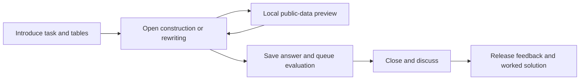

# Relational Algebra Lab: plugin design

Status: target design, 2026-11-06. The engine slice is implemented; the lesson,
authoring and interfaces remain planned. See the
[v1 contract](relational-algebra-contract.md) and
[R0/R2 validation record](relational-algebra-r2-validation.md).
See the [implementation plan](relational-algebra-plan.md) and
[worked examples](relational-algebra/README.md).

## 1. Purpose and assessment claims

Students construct logical query trees, inspect intermediate relations, and
improve a tree using justified rewrites. The first fictional-library lesson asks:

> Which members have an open loan for a database book?

Students explain which operator removes a row or attribute, why a join needs its
condition, and why different trees can answer the same question.

V1 uses classical set relational algebra: tuples are unordered and unique;
projection removes duplicates. It deliberately excludes NULL, SQL bag semantics,
aggregation, outer joins and physical access paths. The basic model follows
[Database System Concepts, chapter 2](https://www.db-book.com/slides-dir/PDF-dir/ch2.pdf).
The bounds and interface below are our design choices.

Two expressions agreeing on finite instances are not thereby proved equivalent.
General equivalence concerns all legal instances under the stated semantics,
as defined in [chapter 16](https://www.db-book.com/slides-dir/PDF-dir/ch16.pdf).
Use two separate exercise modes and different feedback:

- **Construction:** “Matches all exercise checks.” Multiple trees may pass a
  finite public/private instance suite. This is formative assessment, not proof
  of general equivalence or a complete grading oracle.
- **Guided rewriting:** “Verified using these rewrite rules.” The engine checks
  every permitted transformation and side condition, deriving successor trees.
  A successful chain establishes equivalence to the supplied baseline within
  this set-algebra model. The rule set is deliberately incomplete.

Neither mode grades by reproducing a particular serialized tree.

## 2. Classroom and phone workflow

1. **Introduce:** show the task, schemas and small public tables.
2. **Open:** students choose relation leaves, wrap them with operators, connect
   inputs and choose typed attributes/conditions. A rewrite exercise starts from
   a supplied tree and offers applicable rules, preview and undo.
3. **Inspect:** explicit “Run preview” evaluates only the displayed data.
   Tapping a node shows its header, tuple count and paged table. Incomplete
   branches remain editable with an explanation of what is missing.
4. **Submit:** save the bounded answer and queue authoritative evaluation.
   Show saved/pending status; withhold private-check feedback until release.
5. **Close and discuss:** retain accepted pending work. Project anonymous counts
   and an explicitly selected public-data demonstration.
6. **Reveal:** show the student's outcome and worked explanation. Compare several
   valid trees. Private fixture data is not automatically revealed.



Use a vertical outline and explicit Add operator, Replace input, Move selection
and operand controls at 320 CSS pixels. Drag-and-drop is optional. Show names
beside mathematical symbols; color is supplementary. Preserve drafts, focus,
selected nodes and scrolling across unrelated class updates. Do not send an
evaluation on each keystroke. The product interface is not a JSON editor.

## 3. One provider, two capabilities

| Proposed identifier | Purpose |
| --- | --- |
| Distribution `texstage-relational-lab` | One portable wheel |
| Provider `io.github.stefanjdecker.relationallab` | Engine, lesson, style and resources |
| Engine `io.github.stefanjdecker.relationallab.algebra` | Bounded evaluation and rewrite verification |
| Content type `io.github.stefanjdecker.relationallab.tree` | Authoring, state, projections and four surfaces |
| Style `texstage-relational-tree.sty`; namespace `relational` | Prepared-authoring wrapper |
| Proposed `\relationaltree{item}{width}{height}` | Places a prepared activity |

The distribution, provider and engine identifiers are implemented locally.
The lesson and style identifiers are reserved by this design; no catalog release
is published.

Use one distribution because immediate phone previews and authoritative
evaluation should share pure algebra code **inside their own provider**. This
avoids importing a sibling provider's browser modules. The engine is still a
separately declared capability; other content types can bind to it normally.
Split packages later only if a real reuse/dependency requirement warrants it.

Participant preview receives only public data and has no grading authority.
The presenter evaluator revalidates against the fixed approved seed, including
private instances. Private bindings must never be exposed to phones to enable
preview. No client-computed grade is accepted by the reducer.

Texstage retains authentication, epochs/receipts, persistence, job supervision,
validated result transport, asset serving and renderer lifecycle. Domain
semantics, teaching phases, grading, style and displays stay in the provider.
No algebra-specific core routes/tables are added. SQL/SPARQL and lecture-tools
remain independent.

## 4. Algebra, types and bounded representation

Attribute identities are case-sensitive names, distinct from localized labels.
Types are `int`, `text` and `bool`; booleans are not integers. Text is NFC,
case-sensitive, and supports equality/inequality only. Ordered comparisons
require integers. No implicit conversion, SQL parser or arbitrary expression
execution is involved.

Headers compare by attribute name/type, not display order. Canonical relations
sort attributes and tuples deterministically. Duplicate source tuples are
normalized as sets with an author diagnostic. Display ordering is not query order.

Canonical attribute order is ASCII name order. Tuple comparison follows that
header: integers numerically, booleans false before true, and text by Unicode
scalar value after NFC normalization, without locale collation. The
[v1 contract](relational-algebra-contract.md) fixes the versioned digest payload
and ASCII JSON escaping. Python and JavaScript are checked on non-BMP text as
well as the ASCII examples.

| Operator | V1 meaning |
| --- | --- |
| Relation | Read a named relation from the selected instance |
| Selection | Retain tuples satisfying a conjunction of typed comparisons |
| Projection | Keep named attributes and eliminate duplicate tuples |
| Rename | Simultaneously rename attributes; final names must be unique |
| Product | Combine every pair; input attribute names must be disjoint |
| Theta join | Product restricted by the supplied condition |
| Union / difference | Set operations requiring identical named headers/types |

These meanings follow the basic algebra in
[chapter 2](https://www.db-book.com/slides-dir/PDF-dir/ch2.pdf).
Self-joins require explicit renaming. V1 does not invent aliases or natural-join
columns. Intersection, division, disjunction, formula parsing, SQL translation
and physical optimization are later extensions.

### Flat tree format

Use a flat left-to-right postorder array, avoiding recursive portable schemas.
Each child index refers to an earlier node; the final node is the root. Every
other node has exactly one parent. Reject cycles, dangling indices, shared
subtrees, unreachable nodes and noncanonical postorder. Repeated relation
leaves are allowed. The editor's serializer maintains this format.

```json
[
  ["rel","books"],
  ["select",0,[["eq",["a","topic"],["v","db"]]]],
  ["rel","loans"],
  ["select",2,[["eq",["a","open"],["v",true]]]],
  ["join",1,3,[["eq",["a","book"],["a","item"]]]],
  ["rel","members"],
  ["join",4,5,[["eq",["a","borrower"],["a","member"]]]],
  ["project",6,["name"]]
]
```

Other forms: `["rename",child,[["old","new"]]]`, `["product",left,right]`,
`["union",left,right]` and `["difference",left,right]`. Projection names and
rename sources are unique; renames are simultaneous. Conditions contain one
to three atoms `[comparison,operand,operand]`. Operands are `["a",attribute]` or
`["v",literal]`. Comparisons: `eq/ne/lt/le/gt/ge`; the latter four require integers.
The task's operator allowlist is enforced by the evaluator.

Student diagnostics refer to operators and attributes, not wire-format indices.
Results bind to the exact submitted answer digest so stale node indices cannot
refer to a different draft.

### Proposed hard bounds

| Dimension | Limit |
| --- | --- |
| Relations / columns per base relation | 4 / 6 |
| Rows per base relation / instances | 12 / 4: one public, up to three private |
| Relation/attribute IDs | 1–12 ASCII lower-case letters/digits/underscore, starting with a letter |
| Text value / integer magnitude | 24 Unicode code points / 1,000,000 |
| Tree nodes / depth / intermediate width | 16 / 8 / 12 attributes |
| Distinct rows per intermediate | 256 |
| Charged pair/predicate work | 100,000 operations per authoritative job across all instances |
| Local preview work | 25,000 operations on the one public instance |
| Rewrite steps | 8 |
| Canonical answer, including mode and tree/steps | 1,800 ASCII-escaped JSON bytes, within the host's 2,000-character input |
| Engine seed / typed data / complete outcome | 64 KiB UTF-8 / 8 KiB / 12 KiB |
| Pilot participants / item-state target | 64 / 192 KiB |

All bounds apply jointly. A shape limit does not waive its encoded byte limit.
Budget exhaustion is operational, not proof of a wrong query. Authoring must
verify that references/baselines and required examples fit. Reject duplicate
JSON keys, non-finite values and type coercions.

Charge each visited input tuple, candidate pair and comparison atom before
performing it. In rewriting, the budget covers the baseline and all derived
trees across all checked instances; it does not restart at each step. Stream
candidate pairs and stop at the row/work limits rather than building an
unbounded product first. Canonicalization also needs the host's wall-time guard.

Preview runs on explicit actions using cooperative bounded execution that
yields in short chunks and cancels on edits. Use an owned worker if measurements
require it, with host-supported serving/policy and cleanup tests. It must not
become a separate execution path that bypasses restrictions or receives private
data. Local results never become authoritative grades.

## 5. Assessment and proof rules

### Finite construction checks

At preparation, an independent Python model evaluates the teacher's reference
on every instance and stores expected named-header/relation digests privately.
The engine returns the corresponding digests for the student's tree. The
reducer verifies exercise/answer identity, exact fixture coverage, structural
task constraints and all expected results.

A mismatch on a legal instance is a counterexample. A complete match is finite
evidence only. Hide expected digests, private rows and per-fixture diagnostics
from public projections. Reference trees/worked explanations are separately
revealable. Do not grade through equality of complete canonical analyses or
through host `matches`.

V1 declares no keys, foreign keys or other integrity constraints. ID-looking
columns do not imply a key to the rewriter. Constraint-dependent proofs require
a future explicit, verified contract.

### Guided rewrite certificates

| Rule | Transformation and side condition |
| --- | --- |
| `split-select` | Split a conjunctive selection into nested selections |
| `push-select-left/right` | Move selection into an inner-join/product side only when all its attributes are there |
| `product-to-join` | Replace selection over a product with a theta join |
| `collapse-project` | Remove an inner projection when it retains all outer attributes |

These are restricted instances of
[chapter 16's equivalences](https://www.db-book.com/slides-dir/PDF-dir/ch16.pdf).
`split-select` requires at least two atoms; the first stays outer and the rest
form the inner selection.

Submit steps `{"rule":"...", "path":[0,1]}` relative to the **current** root.
The evaluator applies each rule itself, derives the successor, checks its side
conditions and enforces tree/type/budget bounds. It never trusts a supplied
replacement tree. Empty sequences cannot satisfy an improvement task.
Inapplicable steps receive a bounded diagnostic identifying the failing step.
General projection pushdown and join reordering are deferred pending their own
side-condition checks and tests.

### Explain work without pretending to be a physical optimizer

Logical operators differ from physical access paths and execution algorithms;
see [CMU's query-planning notes](https://15445.courses.cs.cmu.edu/fall2025/notes/15-optimization1.pdf).
Use an explicitly illustrative materialization metric on the displayed instance:

`M(tree, instance) = sum(rows(node) * columns(node))` over non-leaf nodes.

Call this **intermediate output cells**, not runtime or optimizer cost. The worked
library's late-filter tree emits 83 cells; the early-filter tree emits 51; both
produce `{Ada}`. Another instance may yield another comparison. A rewrite task
may require a verified chain and `M(final) < M(baseline)` on the public instance,
but makes no global optimality claim and never compares different phones' times.

## 6. Typed results and storage

Proposed analysis facts include format, exercise/answer digests, mode, validity,
per-fixture header/relation digests, bounded public node counts and the public
metric. Rewrite facts add proof status, verified-step count and the derived
flat tree. Invalid domain answers contain reasons/locations, not fabricated
digests. Operational failures cannot fill a successful graded result slot.

The final schema must use the current portable profile: bounded nonrecursive
arrays/objects, closed variants and acyclic local definitions. Source schemas
may use richer validation, but semantic typing remains explicit. Measure worst
allowed outputs against both host validators, including the derived rewrite
tree. Do not raise host limits to transport all intermediate tables.

Full intermediate tables and private-instance traces are **not** evaluation
facts. Phones compute public previews locally; the presenter computes public
comparison tables from the chosen tree. Persist only one current answer/outcome
slot per actor, capped at 2.5 KiB including its key, plus 32 KiB shared state.
64 slots plus shared state fit the 192-KiB target. Keep the structured answer
once and compact feedback, not the complete typed engine analysis or a second
copy of a derived tree. Do not retain each draft, preview page or a second copy
of private reference data in every actor's state.

The current host caps the **whole transition**, state plus effects, at 256 KiB
and each projected view at 128 KiB. A replacement emits at most one cancellation
and one evaluation effect; it does not re-evaluate the entire class. Measure
the serialized envelope including escaping. Presenter views carry aggregate
counts and a selected answer, rather than all 64 full answers. The 64-KiB seed
is a provider limit below the current host limit; none of these choices requires
raising a host ceiling.

| Audience | Before feedback release | After feedback release |
| --- | --- | --- |
| Participant | Own draft/saved answer, public preview, receipt/pending | Own outcome and permitted worked explanation |
| Projector | Public tables, phase/counts, explicit public-data demonstration | Aggregates and shared comparison trees; no actor IDs or private fixtures |
| Presenter | Controls, counts and necessary private diagnostics | Worked solution and unresolved operational failures |

Sharing a submitted tree requires an explicit presenter action, removal of
identity, and a sharing notice before participation. V1 collects no free-form
student prose labels. These are formative activities, not secure exams;
repository examples and their expected answers are intentionally public.

## 7. State and editable surfaces

Each item uses `introduce -> open -> closed -> revealed`. Reset creates a new
epoch. Reopen retains answers and advances phase/control guards. Each actor slot
has its own answer version, canonical answer/digest, correlation and compact
pending/completed outcome.

| Command | Role and guard |
| --- | --- |
| `submit-tree` / `submit-rewrite` | Participant; open phase, phase token and own expected answer version |
| `open` / `close` / `reveal` / `select-demonstration` | Presenter; epoch and control version |
| `_reset` | Host-owned reset using its epoch/receipt contract |

Use `evaluation_correlation(actor, request_id, slot)`. Replacements supersede old
analysis; completion must match actor, epoch, correlation, answer version and
digest. Closing retains accepted pending work. Lost-ACK retries reuse receipts.
Unrelated submissions do not stale presenter controls.

Keep local dirty drafts separate from server answers. A newer save from another
device must offer reload/keep-draft choices, not overwrite typing. Reset/item
replacement marks old drafts obsolete. Apply preview results only to the current
draft. Presenter overlay, presenter controls, projector overlay and participant
input use the declared facade and owned assets. Failure/status feedback must
distinguish closed/stale/unavailable from mathematical incorrectness.

## 8. One-source authoring and export

One JSON source provides public tables, private instances, task policy and the
reference/baseline. A revision-2 `authoring_hook` prepares live data and both
exercise/solution TeX. The proposed style is a thin wrapper:

```tex
\usepackage{texstage}
\usepackage{texstage-relational-tree}
\begin{frame}{Which members borrowed database books?}
  \relationaltree{db_borrowers}{.94\linewidth}{.58\textheight}
\end{frame}
```

An explicit activity sidecar selects the proposed content type/source. This
command is planned syntax, unavailable today. Public editions show the task,
tables and a starter/space for a tree; solutions add the worked tree, counts and
justified steps. Live, handout, solutions, static PowerPoint and local direct-TeX
exports must agree and reject stale sources/assets. A style never installs the
provider, and no styles are copied into existing courses.

## 9. Shared host work and release limits

Typed facts and pre-TeX preparation exist locally. Shared prerequisites are:

- Preserve the [verified Firefox/WebKit worker fix](worker-browser-compatibility.md)
  and its unchanged network and child-worker restrictions.
- Preserve structured command refusals so clients can distinguish stale answer,
  closed phase and operational failure.
- Reconcile removed/replaced descriptors and mounts while preserving edits;
  discard obsolete asynchronous preview results.
- Measure fair bounded scheduling, evaluator availability and publication costs.
  Public local previews must not create server jobs.
- Publish and pin the compatible host for hosted collection conformance.

The [relational engine validation](relational-algebra-r2-validation.md) records
the current browser checks and remaining host work. No host code changed in
this milestone. The original [worked-example checks](relational-algebra/validation.json)
remain specification evidence, separate from installed-engine conformance.

The target is a **measured 64-participant pilot**. A 200-participant version needs
evidence and likely generic state/projection improvements, not just a higher
plugin constant. Existing courses, pins, original/archived checkouts and private
media remain unchanged.
