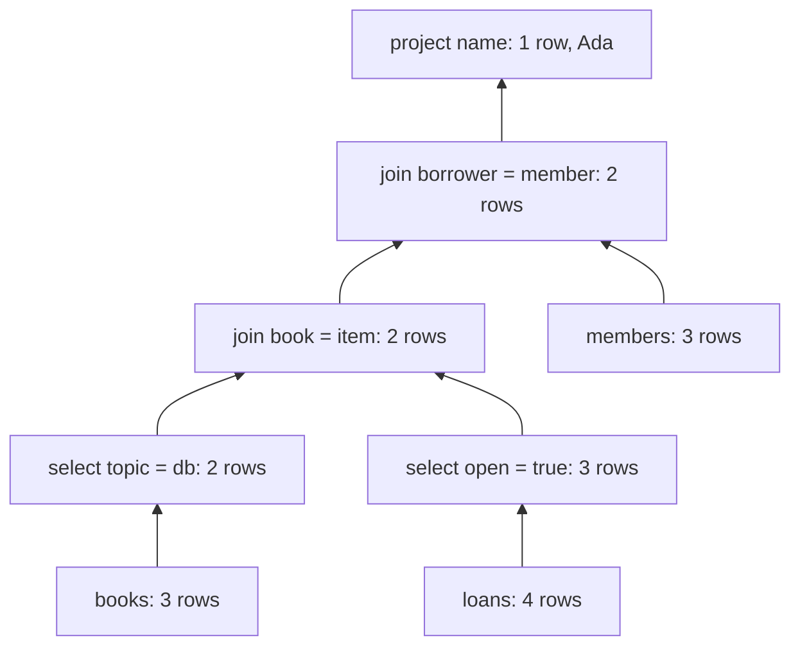

# Worked design examples: relational algebra

These sources are now accepted by the installed engine's
[v1 contract](../relational-algebra-contract.md). They are not yet classroom
activities: prepared authoring and the lesson interfaces remain pending.
The [design](../relational-algebra.md) defines the semantics and limits; the
[plan](../relational-algebra-plan.md) lists the remaining classroom work.

## The library question

> Which members have an open loan for a database book?

The visible instance contains three books, four loans and three members.
Attribute names differ across relations so joins state their conditions:

| Relation | Columns | Relevant facts |
| --- | --- | --- |
| `books` | `book, title, topic` | Data and Graphs have topic `db`; Networks has topic `net` |
| `loans` | `loan, borrower, item, open` | Ada has two open database-book loans; Ben has an open Networks loan; Cora's Data loan is closed |
| `members` | `member, name` | 1 = Ada, 2 = Ben, 3 = Cora |

Join `book = item` and `borrower = member`, filter `open = true` and
`topic = "db"`, then project `name`. The result is the set `{Ada}`: Ada appears
once even though two loans qualify.

The [construction source](construct.exercise.json) includes three additional
instances for the teacher's finite checks:

| Instance | Change from the visible tables | Expected names |
| --- | --- | --- |
| `shown` | Public tables | Ada |
| `renamed` | Change Ada's name to Dina | Dina |
| `topics` | Data becomes `net`; Networks becomes `db` | Ada, Ben |
| `closed` | Close every loan | Empty relation, still with a `name:text` header |

Selecting `name = "Ada"` directly from members happens to pass the visible
instance and fails `renamed`. Omitting either filter also has a concrete
counterexample. Passing these four instances is useful feedback, but is not a
proof for every possible database.

The example sources and their answers are deliberately public teaching material.
Their `visibility` fields describe the proposed live role separation. During
preparation, private fixtures go only into private engine bindings; uploading a
raw example source as public slide content would not provide that separation.

## Two trees, the same answer

The late-filter tree joins all three relations and then applies both filters.
The early-filter tree filters books and loans first:



Count output cells at non-leaf nodes, including the final projection:

| Tree | Contributions on the visible data | Total |
| --- | --- | --- |
| Late filtering | `4×7 + 4×9 + 2×9 + 1×1` | 83 |
| Early filtering | `2×3 + 3×4 + 2×7 + 2×9 + 1×1` | 51 |

This metric illustrates materialized intermediate results. It is not an estimate
of a real database's running time, I/O or choice of physical join algorithm.

## A checked rewrite exercise

The [rewrite source](rewrite.exercise.json) starts with the late-filter tree.
The [expected cases](expected-cases.json) include this five-step certificate:

1. Split the combined selection: `open` stays outer, `topic` becomes inner.
2. Push the `topic` selection below the join with members.
3. Push the `open` selection below the join with members.
4. Push `topic` into the books input of the books/loans join.
5. Push `open` into the loans input of that join.

Each push requires all attributes of its selection predicate to belong to the
chosen input. The evaluator derives the new tree from the rule and current
path. It does not accept a student-supplied replacement as proof. The expected
cases also contain a refused push toward members, whose header lacks the
required attributes.

The engine will verify the rule certificate and its side conditions. Replaying
it on sample data is an additional design check, not the justification for the
rewrite laws.

## Files and verification

| File | Purpose |
| --- | --- |
| [construct.exercise.json](construct.exercise.json) | Bilingual task, typed schemas, four instances and teacher reference tree |
| [rewrite.exercise.json](rewrite.exercise.json) | Bilingual rewrite task, public baseline, permitted rules and improvement goal |
| [expected-cases.json](expected-cases.json) | Six construction cases, eight operator cases, valid certificate and invalid push |
| [validation.json](validation.json) | Dated checks, source hashes and explicit exclusions |

From the collection root, run:

```sh
python maintenance/check_relational_design.py
```

The standard-library checker independently evaluates the hand-derived cases,
replays each of the five steps on all four instances, rejects the invalid push,
and cross-checks the library query with SQLite `SELECT DISTINCT` on four
in-memory databases. Its use of SQLite is limited to this no-NULL example; it
does not establish general SQL/relational-algebra equivalence.

The check covers 14 operator/construction cases, the five-step chain and the
invalid push. The largest supplied answer is 297 ASCII-escaped JSON bytes,
within the proposed 1,800-byte limit. These small examples do not prove
worst-case budgets. The checker handles the supplied trusted fixtures; it is
not the production parser, a complete schema validator or the plugin runtime.

The separate [R0/R2 validation](../relational-algebra-r2-validation.md) covers
the implemented schemas, algebra, rewrite rules and installed engine.
Privacy/state races, phone integration and the 64-participant workload remain
implementation gates. This original design-check record makes no browser,
runtime, classroom-capacity or release claim.
