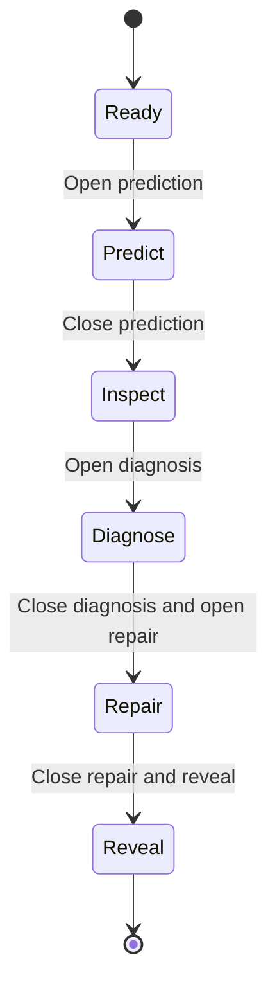

# Transaction schedules: plugin design

> Implementation update: the classroom package, prepared authoring, four views,
> actor records, private feedback and generic host archive integration are now
> implemented on `codex/transactions-classroom`. See the
> [validation record](transaction-classroom-validation.md) for measured results
> and remaining classroom/release gates. The planning text below preserves the
> original acceptance criteria; it is not a claim that every gate has passed.


Planning baseline: M2's independent engine was implemented on 2026-11-06. The classroom
completion plan was revised on 2026-11-07 against the published host
`f612a366ddde07b79a6d5f70160d7ac9db8bd880`. Lesson state, authoring and interfaces
below were planned at that revision; see the implementation update above for
current status. The [completion plan](transaction-schedules-plan.md)
defines current dependencies, actor-record storage, a 600-student target and
1,000-student ceiling, implementation order and release gates.
The [original host contract review](https://github.com/stefanjdecker/texstage/blob/f612a366ddde07b79a6d5f70160d7ac9db8bd880/docs/architecture/transaction-plugin-review.md)
is historical context; many of its prerequisites now exist. Host code is maintained
once and mirrored to GitHub and GitLab; the legacy checkout is archived.

## 1. Purpose and first release

Students predict an interleaved execution, explain its conflicts, and construct
a valid repair. The lecturer can inspect class responses without publishing
individual identities. The activity supports the DBIS2027 transaction chapter's
progression from lost updates through schedules to conflict graphs.

The first release teaches these distinctions:

- Each transaction has its own remembered read values.
- Program order inside a transaction must be preserved by an interleaving.
- A conflict requires different transactions, the same object and at least one
  write; multiple operation pairs can justify the same directed edge.
- Conflict serializability is established by an acyclic conflict graph.
- Several repairs can satisfy the task. Matching one sample answer or one final
  database state is not the criterion for accepting a repair.

The graph criterion and conflict rules follow the
[CMU concurrency-control lecture notes](https://15445.courses.cs.cmu.edu/fall2025/notes/17-concurrencycontrol.pdf).
The executable examples below are newly authored synthetic exercises.

Version 1 uses complete schedules with two or three transactions, one to three
integer-valued objects, at most twelve read/write operations in total, and one
terminal commit per transaction. Reads, writes and commits are atomic steps.
Writes take either a constant or a named earlier read from the same transaction
plus an integer increment. No student-supplied expressions are executed.

Aborts, rollback, lock protocols, MVCC, SQL isolation levels, predicate reads,
phantoms, deadlocks and recovery are later activities. The committed-only model
avoids silently choosing a convention for removing aborted transactions from a
conflict graph. It is a teaching simulator, not an implementation of a DBMS.
It makes no claim to decide general or view serializability.

## 2. Packages and ownership

Use two independently installable packages in the collection. Names below are
proposed local identifiers, not claims of registration on a package index.

| Distribution | Provider and capability | Responsibility |
| --- | --- | --- |
| `texstage-transaction-engine` | `io.github.stefanjdecker.transactionengine`; engine `.schedule` | Validate and analyze a bounded schedule; return trace, direct conflict edges and a certificate |
| `texstage-transaction-activity` | `io.github.stefanjdecker.transactionactivity`; content type `.schedule` | Authoring, classroom phases, submissions, feedback rules, four views and static outputs |

The activity declares an evaluation binding to the engine. It never imports the
other provider's browser modules. The engine has no LaTeX style. The activity
owns `texstage-transactions-schedule.sty`, namespace `transactions`, and the
environment `transactionsschedule`.

Texstage owns authentication, epochs, receipts, persistence, worker supervision,
validated result transport, reset, archives, navigation and renderer lifecycle.
Transaction semantics, teaching phases, graph notation, answer validity and
repair objectives stay in the packages. No transaction-specific route, message
kind, database table or correctness rule is added to the core.

Keep the coordinate/distance fixtures as the independent smoke test. These
packages are an additional, more demanding conformance example.

## 3. Classroom interaction

A typical activity takes approximately five to eight minutes; the lecturer
controls its pace. Initial implementation has one live frame and a monotonic
phase sequence. Navigating away pauses participation without resetting it.
Returning preserves the phase and answers; a paused answer phase resumes only
on the presenter's explicit command. Previously revealed phases stay closed.



Reset is a separate core action from any phase: it starts a new item epoch in
Ready. Rewinding the execution cursor inside Inspect changes the explanation
view, not the already accepted predictions. Earlier answer phases are not
reopened after their answers have been shown.

| Phase | Phone | Presenter controls | Projector |
| --- | --- | --- | --- |
| Ready | Prompt, model assumptions and transaction programs | Open prediction | Initial values and an unanswered schedule |
| Predict | Enter final values; replace one's own submitted prediction until closure | Response count; close prediction | Submitted count, without revealing a modal answer |
| Inspect | Frozen prediction and the lecturer's execution step | Next/previous step; jump to a step | Shared database, transaction-local reads and the current operation |
| Diagnose | Add directed transaction edges, select one operation-pair witness per edge, then supply a cycle or serial order | Completion count; close diagnosis | Original schedule; no correct graph yet |
| Repair | Reorder the same operations, preserving each transaction's program order; submit a repair | Pending/completed counts; reveal | Progress and anonymized participation counts |
| Reveal | Own current answers and explanations | Select a synthetic or explicitly anonymized example | Answer distributions, graph certificates and multiple valid repairs |

At Inspect, executing the final write necessarily reveals the original final
values. Graph correctness is withheld until Reveal. A monotonic
`prediction_revealed` flag releases final-value feedback when the final inspection
step is reached or Diagnose begins; rewinding the cursor cannot retract it.
Receipt acknowledgements and
input-structure errors are always visible; the configured teaching policy
controls when correctness and explanations appear.

There is no automatic global score or leaderboard in version 1. The activity
gives formative feedback. A missing evaluator means pending analysis, never an
incorrect answer. Reveal does not wait indefinitely for jobs: it shows the
pending count and fills in accepted results when they arrive.

## 4. A complete running example

The [counter exercise](transaction-schedules/counter.exercise.json) starts with
`x = 100`. Both T1 and T2 read x and later write their remembered value plus 10.

| Step | Operation | Read remembered by that transaction | Shared x afterwards |
| --- | --- | --- | --- |
| a1 | T1 reads x | 100 | 100 |
| b1 | T2 reads x | 100 | 100 |
| a2 | T1 writes its a1 value + 10 | 100 | 110 |
| b2 | T2 writes its b1 value + 10 | 100 | 110 |
| a3 | T1 commits | unchanged | 110 |
| b3 | T2 commits | unchanged | 110 |

The ordered conflict pairs are (a1,b2), (b1,a2), and (a2,b2).
The first and third justify T1 → T2; the second justifies T2 → T1.
The cycle explains why this schedule is not conflict serializable.
It is not enough to select just one direction because two conflicts share it.

Both `a1,a2,a3,b1,b2,b3` and `b1,b2,b3,a1,a2,a3` are valid repairs.
So is `a1,a2,b1,b2,a3,b3`: it is interleaved but its conflict graph is acyclic.
All three finish at 120. The repair validator accepts these through the
declared objective, not comparison with one canonical reference schedule.

The [conformance cases](transaction-schedules/cases.json) also include independent
objects, read/read pairs, write/write conflicts, a three-transaction chain and a
cyclic blind-write example whose final state matches a serial execution.
The last example must be labelled "not conflict serializable", not "not
serializable".

## 5. Phone and presenter interface

The phone uses a vertical sequence of operation cards, with transaction labels
and symbols as well as colors. Reordering has Move up/Move down and "insert
before" controls; drag-and-drop is optional. Invalid local moves can be blocked,
but the server still validates the complete submitted order.

Graph construction uses a small matrix of directed-edge toggles. Selecting an
edge opens two operation selectors for its witness. There is no requirement to
draw precise lines on a phone. Every proposed edge needs one valid witness;
students do not have to enumerate all pairs that imply the same edge. A
transitively implied edge without a direct conflict is not a graph edge.

Presenter overlay, presenter controls, projector overlay and participant input
are separate mounts. Controls include phase transitions, cursor stepping,
counts, pending-work status and reset. Projector data has no participant IDs,
request IDs, names, pending submission text or private feedback.
The planned activity uses a revision-3 manifest with actor records and a
separate closed `view_schemas` resource for each surface, so accidental extra
fields fail host validation. The independent engine remains revision 2.

Support German and English labels and explanations. Engine facts and persisted
reason codes are language-neutral. Use native focusable controls, visible focus,
screen-reader labels, at least 44-CSS-pixel touch targets and reduced-motion
support. Keyboard-only operation must complete every task. Check a 320-pixel-wide
phone, browser zoom and the projector layout in real browsers.

An ordinary state update must not replace an unfinished local edit or move its
focus. Reconnect restores the last acknowledged answer; an unsubmitted draft is
labelled as such and is never submitted automatically. A new epoch or exercise
identity clears old drafts. A full reload may lose an unsaved draft in the first
implementation; the interface must not describe that draft as saved.

## 6. Data, simulation and analysis

The [draft exercise schema](transaction-schedules/activity-v1.schema.json) is
independent of the host's plugin manifest version. Its semantic validator also
checks global operation-ID uniqueness, declared objects, earlier own reads,
exactly one final commit, and the twelve-read/write-operation limit.

The schedule must contain every declared operation exactly once and preserve
each transaction's declared order. Writes based on a read use the value captured
at that read, not a fresh read at the write. Commits do not change object values.
Initial values and constants are within ±1,000,000 and increments within ±10,000;
the bounded model stays within exact integer arithmetic in Python and JavaScript.

Analysis returns:

- Final object values and a bounded per-step trace, including local read values.
- Direct conflict edges with operation-pair witnesses, deterministically ordered.
- An acyclic flag and one deterministic topological order, or an explicit cycle.
- A normalized submitted order, exercise digest and analysis format identity.

A cycle is a negative certificate for conflict serializability only. A graph
display for a prefix is labelled as a prefix; the complete-schedule verdict is
computed separately. Disconnected vertices remain present. Multiple valid
topological orders and repairs are accepted.

The browser engine receives a fixed, build-approved seed and a short JSON string
such as `{"order":["a1","a2","b1","b2","a3","b3"]}`. This stays within the existing
2,000-character evaluation-input limit. Phones cannot choose seeds, references
or engine IDs.

The implemented engine result has a normal text summary plus schema-validated
structured `data`. The H1 host follow-up implements this transport.
The engine declaration adds a resource path
`result_data_schema`; the resource hash is part of provider identity.

```json
{
  "status": "ok",
  "canonical": "<deterministic analysis JSON, excluding UI language and actor>",
  "summary": {"kind": "text", "text": "The conflict graph is acyclic."},
  "data": {
    "format": "schedule-analysis-v1",
    "exercise": "<exercise digest>",
    "order": ["a1", "a2", "b1", "b2", "a3", "b3"],
    "valid": true,
    "vertices": ["T1", "T2"],
    "final": {"x": 120},
    "reads": {"a1": 100, "b1": 110},
    "trace": [
      {"operation": "a1", "value": 100},
      {"operation": "a2", "value": 110},
      {"operation": "b1", "value": 110},
      {"operation": "b2", "value": 120},
      {"operation": "a3"},
      {"operation": "b3"}
    ],
    "edges": [{"from": "T1", "to": "T2",
               "witnesses": [["a1", "b2"], ["a2", "b1"], ["a2", "b2"]]}],
    "acyclic": true,
    "serial_order": ["T1", "T2"],
    "cycle": []
  }
}
```

The digest/canonical placeholders above stand for their generated values.
The [implemented schema](../../plugins/transaction-engine/texstage_transaction_engine/schemas/analysis-result.json)
bounds the result. Trace rows contain the operation and its captured or written
value; commits carry only the operation. Replay writes against the initial
object map and reads against the remembered-read map to reconstruct complete
snapshots. This compact form keeps maximum-size exercises within the existing
12-KiB outcome limit and 8-KiB `data` limit. No HTML or executable expressions
are permitted.

A structurally well-formed submission that violates program order produces
`status=ok`, `data.valid=false` and bounded reason codes. That is meaningful
domain feedback, not an engine crash. Syntax failures, timeouts and worker
failures remain separate operational outcomes.

The content-type reducer checks predictions against prepared facts and diagnoses
against the prepared graph. It requests the independent engine for repair
analysis. It accepts a repair iff it is a valid permutation preserving program
order and the analyzed conflict graph is acyclic. Host reference equality and
canonical cache/grouping keys are not used as a correctness decision here.

## 7. State, messages and races

Shared persisted state contains the phase, `phase_token`, `control_version`,
active/paused flags, inspection cursor, prediction-release flag, bounded
aggregates, roster page and explicitly selected/shared snapshots. Host-owned actor records hold each
participant's latest answer for each phase, with `answer_version`, normalized
answer, evaluation correlation and compact outcome status. The actor is supplied
by authentication, never by the phone payload. Use `SaveActor` and the current
record/context API; no full-class answer map travels through every hook.

| Operation | Role | Concurrency guard and effect |
| --- | --- | --- |
| `advance-phase` | presenter | `latest` host policy; compare expected control_version; follow the declared phase transition |
| `seek-step` | presenter | `latest`; compare control_version; only within Inspect and a valid step range |
| `resume-phase` | presenter | `latest`; resume the current paused answer phase, with new phase/control guards; never reopen a revealed phase |
| `roster-page`, `select-answer` | presenter | Bounded roster/record selection with control_version guard |
| `share-answer`, `clear-share` | presenter | Deliberate anonymous snapshot sharing in Reveal, with control_version guard |
| `submit-prediction` | participant | `latest`; compare phase_token and that actor's answer_version; replace only that slot |
| `submit-diagnosis` | participant | Same guards; validate edges, witnesses and certificate |
| `submit-repair` | participant | Same guards; save candidate and enqueue analysis atomically; cancel an older pending repair |
| `retry-analysis` | participant | Retry only the unchanged accepted repair after operational failure, including after closure; preserve answer version and replace its correlation |
| `_reset` | presenter, core-owned | Durable reset of the current epoch; revised epoch guard is implemented by the H1 host |

Transport revision orders whole-item snapshots. It is not the version of an
individual student's answer or the presenter's phase controls. Other students'
submissions must not make a lecturer's cursor click or another student's
submission stale. Two windows editing the same answer do conflict through
answer_version; two presenters conflict through control_version.

The host retains the same request ID across a lost acknowledgement. A terminal
stale-phase or stale-answer refusal is shown, not silently resubmitted. A new
intent uses a new request ID after refreshing the relevant state.

Phase closure and submissions are ordered by their server commits. An answer
accepted before closure remains eligible for its delayed result, even after the
class advances. Each result is applied only to the matching epoch, phase slot,
answer version and current correlation. A newer answer supersedes an older one.
A new epoch invalidates all old work. Do not discard a still-current result
merely because its answer phase is now closed.

Derive correlation IDs from the immutable actor/request identity and a local
effect slot using a deterministic digest. Do not use a request ID alone:
different actors may legitimately use the same request string.

Keep one current answer per actor per phase in one host actor record. Previous
attempts are not accumulated there; receipts and durable jobs remain host-owned.
The revised target is 600 answering students with a 1,000-record ceiling and
25-row presenter pages, subject to the transaction-specific load gates in the
completion plan. The proposed actor-value budget is 3 KiB including reserved
feedback (host ceiling 4,096 canonical JSON bytes), with a 256-byte summary and
32-KiB shared-state target. The complete transition remains within 64 KiB,
below the unchanged host limit of 256 KiB. Prove these targets with worst-case
fixtures before implementation is declared complete.

Store compact answers and small certificates, not a full trace per actor.
Reconstruct detailed feedback from bounded facts; do not rerun analysis in every
audience view. Version 1 steps only the shared original trace. Personal repair
feedback shows final values and a small certificate. Use actor-scoped updates
with explicit broadcast fields for phase, phase token, active/paused flags,
cursor, prediction-release flag and shared example. Participant views omit
per-class counts and rosters.
Every actor must still receive shared phase/reveal/cursor changes.

## 8. Authoring and static outputs

One exercise JSON must determine the simulation, live prompt, static worksheet
and worked solution. It must not require an independent hand-written diagram
and answer table inside a style file.

The current host's generic authoring prepass reads an explicit sidecar before
LaTeX compilation. The transaction hook/style below are now implemented in
`transaction-activity`. A lesson
envelope wraps the existing exercise with checked worked repairs and explanations;
it does not change the engine's exercise-v1 seed contract:

```json
{
  "format": 1,
  "items": [{
    "id": "counter",
    "type": "io.github.stefanjdecker.transactionactivity.schedule",
    "source": "activities/counter.lesson.json"
  }]
}
```

```tex
\documentclass{beamer}
\usepackage{texstage-transactions-schedule}
\begin{document}
\begin{frame}{Two increments, one counter}
  \begin{transactionsschedule}[id=counter]{0.96\linewidth}{5.5cm}
  \end{transactionsschedule}
\end{frame}
\end{document}
```

```sh
texstage build lesson.tex --activities lesson.activities.json --data ./profile --plugins-lock plugins.lock.json
```

The host validates and resolves the sidecar under the authoring root, calls an
enabled authoring hook, and writes only its approved outputs into a fresh build
directory. The hook returns a prepared item plus static exercise/solution TeX
fragments. Source text interpolated into TeX is escaped. The generated fragments
are trusted build artifacts, never code-bearing files in an uploaded bundle.
The TQZ bridge checks that the referenced item, source digest, type and geometry
match the prepared record. The existing post-LaTeX build-hook path stays valid
for simple plugins.

The style consumes the prepared fragments. Present, stage and ordinary handout
output use the unanswered schedule; solutions output includes the trace, graph,
certificate and several repairs. Speaker notes may remain lecturer-only. Static
PowerPoint has the unanswered exercise image. An exported preparation directory
supports direct pdfLaTeX without rerunning a Python hook; changing the exercise
requires explicit preparation again.

The activity's bounded Python authoring analyzer and independent browser
analyzer must agree on the same fixtures and normalized facts. Neither should
use a screenshot as a correctness oracle. The Python helper may later support
notebook exercises, but no existing course notebook is changed in this work.

## 9. Privacy, limits, exports and operation

Public bundle data contains the prompt, program and original schedule.
Prepared traces, correct edges, explanatory certificates and worked solutions
stay in private item data until the applicable reveal. These are teaching
boundaries, not a promise that a student cannot independently solve a public
problem. Trusted lecturer-side code is not an exam-security boundary.

Public projector views contain aggregates and anonymized examples only.
Participant views contain that actor's submitted answers and permitted feedback.
The presenter may inspect current submissions with opaque identifiers; displaying
names or publishing an individual answer requires a separate deliberate feature.

The host already provides bounded queues, adaptive evaluation batches and
reassignment after an observed evaluator disconnect. The lesson must expose
pending/unavailable status, and transaction-specific measurements must establish
throughput and fairness for diverse repairs. A disconnected evaluator cannot
turn pending work into a wrong answer. Cheap answer acknowledgement and phase
closure must remain responsive during a burst.

Archive integration should preserve pins, exercise, accepted answer versions,
outcome codes and a static worked example. A lecturer archive is private.
A public summary is a separate, sanitized projection. Existing screen/window
recording should include the selected projector's overlay; verify it with a real
recorded take. This activity does not require a new event-replay subsystem.
Any future event replay should use authorized snapshots rather than resubmit
student commands or execute a newly installed engine. Archive integration and
actual recording verification remain release tasks.

## 10. Acceptance and implementation status

Run the independent design check now:

```sh
python maintenance/check_transaction_design.py
```

It checks the JSON examples and recomputes the expected arithmetic, conflicts,
certificates, legal interleavings and invalid-order cases. It is a specification
oracle, not the plugin implementation and not evidence of browser integration.

Before classroom use, require installed-wheel tests on both platforms, a real
presenter/projector/phone cycle in Chromium, Firefox and WebKit, keyboard/touch
completion, late results after closure, two devices for one actor, two presenters,
reset/reconnect races, measured 600-participant load and a separately reported
1,000-student ceiling, static outputs and authorized archive/recording checks.
The [plan](transaction-schedules-plan.md) separates existing host mechanisms,
remaining package/core work and those acceptance gates. The existing formative
scope is unchanged; automatic scoreboard points remain a separate follow-up.
