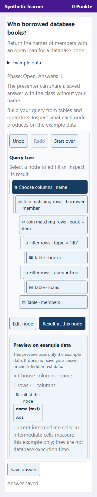
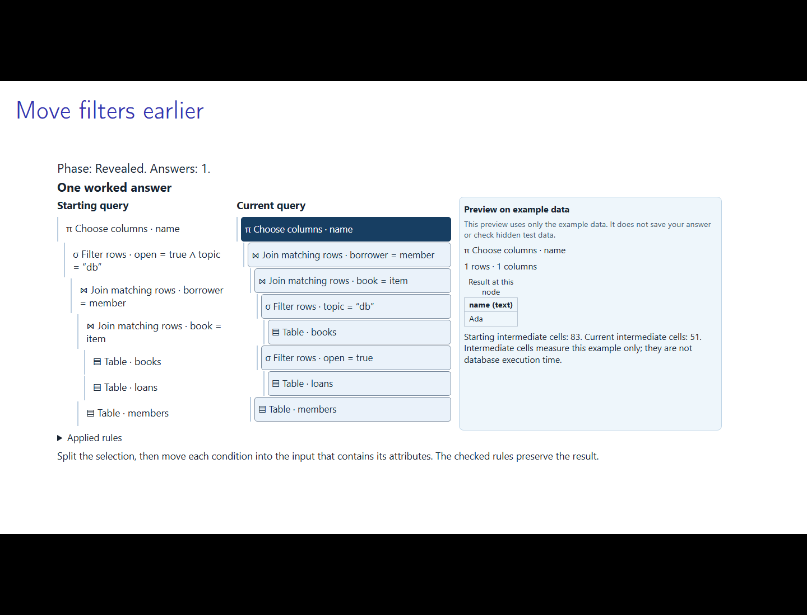

# Build and inspect queries visually

The Relational Algebra Lab 0.2.0 lets students construct query trees and improve
them with rewrite rules. Tables, operators, columns and values have labelled
controls. JSON remains the internal and authoring format; classroom interaction
does not require it.

Use the [installation and lesson guide](relational-lesson.md) to install and
explicitly enable the provider. Start with
[the English example](../examples/relational/lesson.tex) or
[the German example](../examples/relational/lesson-de.tex), using the matching
activity sidecar. The [validation record](design/relational-editor-validation.md)
identifies the tested host, wheels and remaining checks. This is an experimental,
unpublished version; start a fresh environment/session when changing provider pins.

## Construct a query

1. Choose a **Table**, then select **Start with this table**.
2. Select a node in the query tree. Its dark background identifies the selection.
3. Choose an **Operator to add** and select **Add above selected node**. Binary
   operators also ask for a table for the right input. You can subsequently select
   and edit either input branch.
4. Fill in the node's controls. Filters and joins use typed operands and comparison
   selectors; column selection uses checkboxes; renaming uses name fields.
   Select **Apply node changes** to put those edits into the tree.
5. Switch to **Result at this node** to inspect its columns and rows. Select
   another node to see what that intermediate operation produces. Switch back to
   **Edit node** to continue building.
6. Select **Save answer** when ready. The presenter controls when answers are open
   and when authoritative feedback is released.

The available operators depend on the exercise. The plugin supports tables,
filtering, column selection, renaming, all pairs, conditional joins, union and
difference. **Replace this branch with a table** opens additional branch tools,
including removing an operator while keeping an input and swapping binary inputs.
**Undo**, **Redo** and **Start over** support local experimentation.

Unapplied field edits are clearly marked. Apply or discard them before changing
nodes or saving. The editor explains missing columns, incompatible types, name
collisions and size limits. It can retain an invalid intermediate tree while you
repair it, but saving requires a structurally valid answer. These structural
checks do not tell you whether the query answers the exercise correctly.

## Improve a query with rules

In a rewrite exercise the starting tree is supplied. Select a node, choose a
**Rewrite rule**, and select **Apply rule to selected node**. The editor explains
why a rule cannot apply, such as a filter referring to columns outside the chosen
input. Each accepted rule changes the current tree and adds a readable history
entry. Undo removes the most recent change; redo restores it.

The saved answer contains the rule sequence. The authoritative engine derives
the resulting tree itself and checks the rule conditions again. The example's
objective is to reduce intermediate output cells on the displayed database.
This is a teaching metric, not a prediction of database execution time.

## Preview, saving and feedback

The preview uses only the displayed public example. It shows a relation at each
node, including empty results and paginated larger results. Private test data and
reference answers are never needed for that calculation. Preview computation is
bounded, yields to the interface, and ignores obsolete work after edits or teardown.

Previewing does not save an answer or establish correctness on hidden instances.
The presenter's restricted evaluation worker checks saved answers. Feedback follows
the existing introduce/open/closed/revealed phases. An unavailable evaluator is
an operational condition, never an incorrect-answer verdict.

Another student's update preserves the current fields and focus. If another device
saves a newer answer for the same student, choose **Reload saved answer** or
**Keep my draft**. Keeping a draft requires another explicit save. Reset uses the
same explicit choice for an obsolete draft. Navigation disposes the editor;
unsaved work is not promised across leaving the slide or closing the browser.

## Present and discuss

Presenter inspection uses the same readable tree and intermediate table. It stays
private until the lecturer chooses **Share selected answer anonymously**. The
projector then shows the shared tree and its example result; rewrite answers also
compare starting and current trees. Reveal exposes the checked worked answer and
explanation through the existing privacy rules.

The LaTeX command and activity source format are unchanged. Static exercise,
handout, solution and PowerPoint editions still come from the prepared source.
Static trees now use algebra notation instead of serialized arrays; the plugin
fits tall prepared fragments to the height specified by the author.
The plugin's existing 64-actor pilot ceiling, answer sizes, grading policy and
worker restrictions are unchanged. Phone viewport tests are not a physical-device
or classroom-capacity claim.
