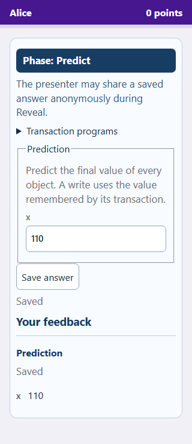
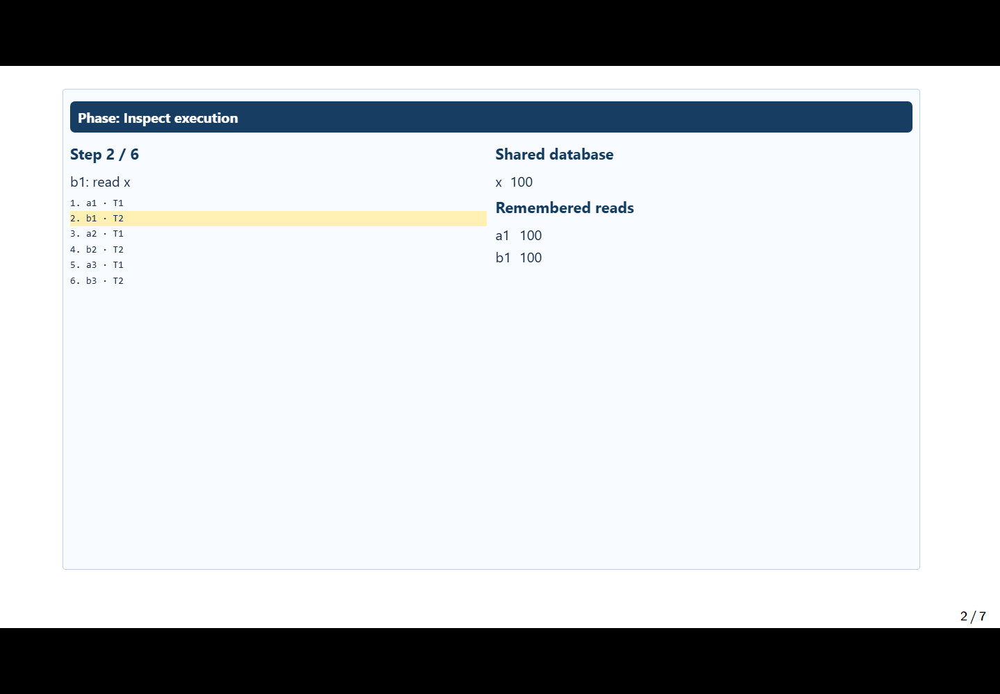
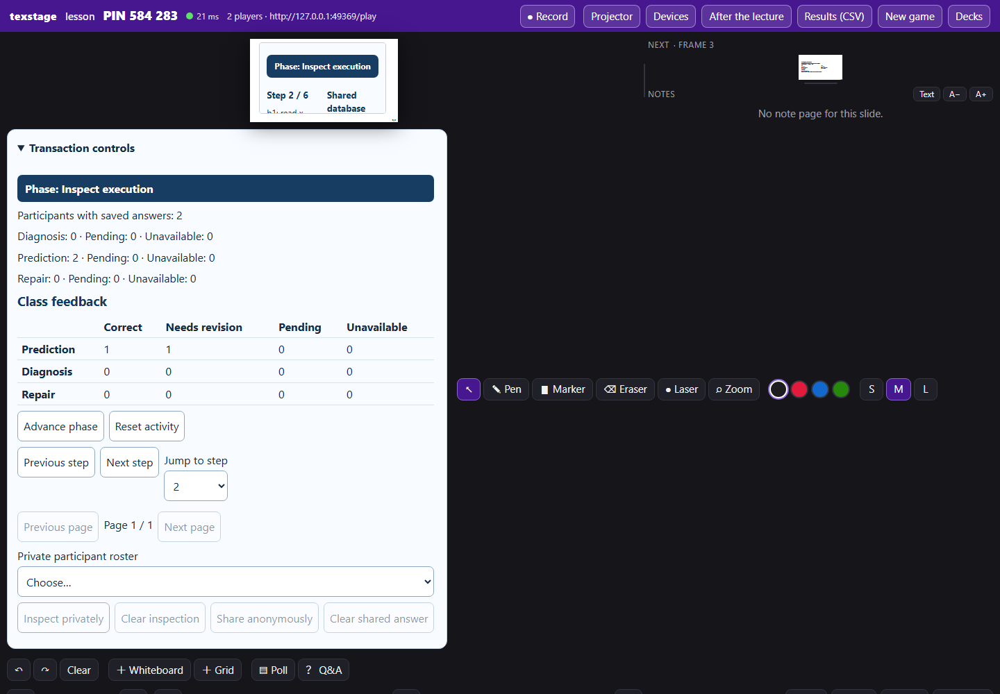

# Transaction schedules lesson

The transaction activity lets a class reason about interleaved transactions:
predict final values, inspect execution, explain conflicts, and repair a
schedule. Students use labelled phone controls. The presenter controls when
answers and explanations become visible. It is a teaching model of remembered
reads and writes, not a database server or an implementation of isolation levels.

Two separately installed packages cooperate:

| Package | Responsibility |
| --- | --- |
| `texstage-transaction-engine` 0.1.0 | Restricted browser evaluation: trace, values, direct conflicts and certificates |
| `texstage-transaction-activity` 0.1.0 | Prepared LaTeX, phases, per-student records, feedback and four browser views |

These are experimental source-built packages. No catalog release is published.
The [validation record](design/transaction-classroom-validation.md) identifies
the tested artifacts and separates automated checks from classroom acceptance.
Version 1 provides formative feedback and **does not award scoreboard points**.

## Install and enable

Use a fresh Python 3.12+ environment with a compatible TeXStage wheel. Build the
host from the accompanying `codex/transactions-classroom` changes, including
the generic archive additions. The base host is
`f612a366ddde07b79a6d5f70160d7ac9db8bd880`; its version string alone does not
identify these unpublished changes. The host must support prepared authoring,
manifest-3 actor records, batched projections, typed evaluation results and
the `Runtime.public_archive` API. Use exact wheel hashes from the validation
record rather than substituting a similarly named development build.

Install pdfLaTeX/latexmk, Latin Modern and English/German Babel support for
authoring. Development checks also need Node 24 and the collection's locked npm
dependencies. From a clean collection checkout and the activated environment:

```sh
python -m pip install --require-hashes -r /path/to/texstage/requirements/dev.txt
python -m pip install --no-deps /path/to/texstage-wheel.whl
python maintenance/build_wheels.py --package transaction-engine --package transaction-activity
python -m pip install --no-deps dist/texstage_transaction_engine-0.1.0-py3-none-any.whl dist/texstage_transaction_activity-0.1.0-py3-none-any.whl
texstage plugins --data ./transaction-profile inspect io.github.stefanjdecker.transactionengine
texstage plugins --data ./transaction-profile inspect io.github.stefanjdecker.transactionactivity
```

Review each provider and copy its printed payload digest into its own command:

```sh
texstage plugins --data ./transaction-profile enable io.github.stefanjdecker.transactionengine --version 0.1.0 --payload ENGINE_DIGEST
texstage plugins --data ./transaction-profile enable io.github.stefanjdecker.transactionactivity --version 0.1.0 --payload ACTIVITY_DIGEST
texstage plugins --data ./transaction-profile lock --output ./transactions.lock.json
texstage present examples/transactions/lesson.tex --activities examples/transactions/lesson.en.activities.json --data ./transaction-profile --plugins-lock ./transactions.lock.json --no-tunnel
```

Enablement is explicit. Uploading a deck or loading a style file never installs
Python or JavaScript code. Keep the presenter browser open while students submit
repairs: its restricted workers evaluate them. Phones need the server's reachable
LAN address; loopback addresses used by the automated tests work on one computer.
Use `lesson-de.tex` and `lesson.de.activities.json` for German.

## Teach the lesson

1. **Ready:** show the original schedule, initial values and transaction programs.
   Explain that writes referring to reads use remembered transaction-local values.
2. **Predict:** students enter one final integer per object and select **Save
   answer**. They may replace their answer while this phase is open. Typing alone
   does not submit. Their saved prediction has no correctness feedback yet.
3. **Inspect execution:** step forward, backward or jump using presenter controls.
   Everyone sees the same cursor, database and remembered reads. Reaching the
   final step releases prediction feedback. Moving backward cannot retract it.
   Advancing to Diagnose also releases the final values and prediction feedback.
4. **Diagnose conflicts:** students select every direct edge, an earlier/later
   operation pair witnessing each edge, and either a cycle or a serial order.
   Read/read pairs do not conflict. A serial certificate includes isolated
   transactions. A cycle ends at its starting transaction.
5. **Repair:** students reorder operation cards using Move up/down or Insert
   before. Undo reverses a move. Each transaction's own program order must remain
   intact. Save sends the order for analysis; any valid acyclic repair can pass.
   A matching final value alone is insufficient evidence of serializability.
6. **Reveal:** release diagnosis and repair feedback, checked explanations and
   alternative repairs. A pending evaluation may finish after Reveal. It remains
   pending or unavailable until actually checked.

The presenter sees counts and a private roster of 25 records per page. Inspecting
an answer does not publish it. **Share anonymously** is available in Reveal;
the projector focuses on that snapshot in place of the worked example. A replacement
clears the selected/shared snapshot. **Clear shared answer** restores the worked
example. Class correctness counts remain private until Reveal; the presenter can
see them earlier in the controls.







## Feedback and recovery

Prediction feedback lists matched and incorrect objects. Diagnosis feedback
distinguishes missing/extra direct edges, invalid operation witnesses and an
invalid certificate. The certificate is checked against the actual graph, not
only the student's proposed graph. Repair feedback checks legal operation order
and acyclicity; it accepts alternatives rather than comparing with one answer.

There is no automatic partial-credit rubric or score publication in this version.
The independent Python model rechecks browser facts before they become feedback.
An engine failure, timeout, wrong identity or inconsistent result produces
**Analysis unavailable**, never an incorrect-answer verdict. The saved answer
remains intact. Use **Retry analysis** once an evaluator is available; retries
also work after Reveal and do not create a new answer version.

Another student's update preserves the current draft and focus. Two devices for
one student use answer versions: **Reload saved answer** replaces the draft;
**Keep my draft** keeps it locally and requires another explicit save. A missing
acknowledgement is safely retried by the host's receipt protocol. Saved answers
survive reconnects and server restarts. Unsaved drafts belong to the mounted
view and are not promised across navigation or browser shutdown.

Leaving a slide pauses an open answer phase. Returning requires **Resume this
phase**. **Reset activity** asks for confirmation, removes all actor records and
starts a new epoch; old jobs and old-device commands cannot restore them.

## Author an activity

Use [the six-case example](../examples/transactions/lesson.tex) and its
sidecar. The prepared environment is:

```latex
\usepackage{texstage}
\usepackage{texstage-transactions-schedule}
...
\begin{transactionsschedule}[id=counter]{.98\linewidth}{.90\textheight}
\end{transactionsschedule}
```

The sidecar maps `counter` to type
`io.github.stefanjdecker.transactionactivity.schedule` and source
`activities/counter.lesson.json`. A lesson source contains `format: 1`, an
`exercise`, two or three distinct `worked_repairs`, and a bilingual `explanation`.
Each worked repair is validated before LaTeX runs. The original exercise has
2–3 transactions, 1–3 integer objects, at most twelve reads/writes and one final
commit per transaction (at most fifteen operations). Operation/object identifiers
are lowercase ASCII, start with a letter, and contain at most twelve characters.
See the [contract](design/transaction-classroom-contract.md) for exact bounds.

Exercise and handout editions contain unanswered problems. Solutions contain
the trace, final values, witnesses, a certificate, alternative repairs and the
explanation. Static PowerPoint uses the exercise edition. Prepared direct
pdfLaTeX exports preserve the same item identities and refuse changed sources.
The German and English maximum-size examples exercise long identifiers and all
fifteen operations. Check your own rendered PDFs when changing text or dimensions.

## Privacy, exports and operating limits

The public deck contains the problem and staged-feedback policy. Private worked
answers, evaluation bindings and server records stay out of the public deck and
participant transport until their release phase. The private `keys.json` is not
served as a bundle file. Treat the built bundle directory as lecturer material.

The lecturer-authorized archive ZIP now includes **private `plugins.json`**,
including saved actor records and jobs. Keep that ZIP private. A separate
presenter-authorized endpoint, `/api/archive/SESSION/plugins-public.json`, exports
only schema-validated projector snapshots, provider pins, epochs and revisions.
It never falls back to private state when a projection fails. It represents the
current projection, not a replay or a full assessment record. Deliberately shared
answers and revealed solutions are therefore included when currently projected.

TeXStage's existing screen/window recording can capture these overlays and cursor
changes. This plugin does not add event replay, recording storage or media uploads.
Keep lecture recordings, scripts and private session exports in private storage.

Each activity admits at most 1,000 distinct actors and keeps one independently
versioned answer for each of the three answer phases. Existing actors can replace
answers at capacity. Records stay below 3 KiB, summaries below 256 bytes and role
views below 64 KiB. Storage capacity is separate from measured throughput: use the
[browser and load results](design/transaction-classroom-validation.md) before
planning a 600-student class or claiming support at the 1,000-student ceiling.

Upgrade into a fresh environment and operator profile, retain old wheels and
lockfiles, and start a fresh session. Roll back using those original artifacts;
do not rewrite a running session's provider identity. Existing courses need not
be changed to try this standalone example.
